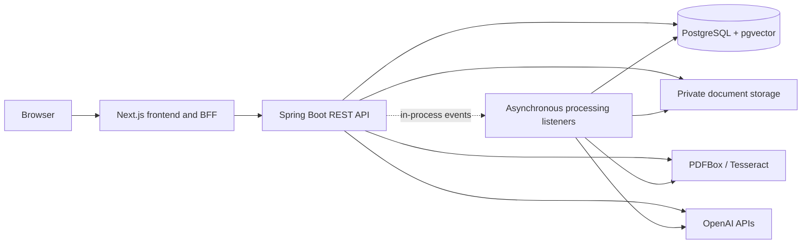
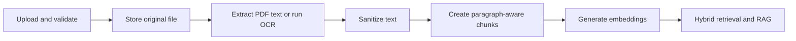

# RAG Document Assistant

RAG Document Assistant is a portfolio application for securely uploading documents, extracting and indexing their content, finding relevant passages with hybrid retrieval, and asking document-grounded questions. The project is implemented as a Spring Boot modular monolith with a Next.js web client and runs locally with Docker Compose or Kubernetes.

Release: [v0.1.0](https://github.com/raf-83/rag-document-assistant/releases/tag/v0.1.0)

## Highlights

- JWT-based authentication with rotating refresh tokens stored in `HttpOnly` cookies by the frontend BFF.
- PDF, JPEG, and PNG upload with size, media-type, PDF page-count, and active-content validation.
- PDF text extraction and Tesseract OCR, followed by sanitization and paragraph-aware chunking.
- OpenAI embeddings stored in PostgreSQL with `pgvector` and an HNSW cosine-distance index.
- PostgreSQL full-text search, semantic search, and weighted Reciprocal Rank Fusion (RRF).
- Document-scoped RAG answers with source chunk metadata and prompt-injection-aware instructions.
- Reproducible local environments with Docker Compose and local Kubernetes manifests.
- Maven tests, frontend lint/type/build checks, GitHub Actions validation, and GHCR image publishing.

## Technology stack

| Area | Technologies |
| --- | --- |
| Backend | Java 25, Spring Boot 4.0.5, Spring MVC, Spring Security, Spring Data JPA, Hibernate |
| Data | PostgreSQL 18, pgvector 0.8.6, Flyway |
| AI and documents | OpenAI Embeddings and Responses APIs, Apache Tika, PDFBox, Tess4J/Tesseract |
| Frontend | Next.js 16.4.0, React 19.2.4, TypeScript, Tailwind CSS 4 |
| Delivery | Maven 3.9.14 via Maven Wrapper 3.3.4, Docker, Docker Compose, Kubernetes, GitHub Actions, GHCR |

See [Technology stack](docs/technology-stack.md) for versions, rationale, and implementation locations.

## Architecture



The backend is a single deployable modular monolith. Package boundaries separate authentication, document management, storage, processing, retrieval, and AI integration. Asynchronous processing uses in-process Spring events; upload and content handoffs run after commit, while embedding generation uses an asynchronous event listener. This is not a durable message queue.

## Document processing



The document state progresses through `UPLOADED`, `TEXT_PROCESSING`, `CONTENT_READY`, `CHUNKING`, and `READY`, or ends in `FAILED`. A `READY` document has persisted content and chunks; semantic retrieval also requires each selected chunk embedding to reach `READY`.

## Hybrid search and RAG

Keyword retrieval uses PostgreSQL full-text search. Semantic retrieval embeds the query and compares it with 1,536-dimensional chunk vectors using cosine distance. `HybridRetrievalServiceImpl` combines both ranked lists with weighted, normalized RRF; `HybridSearchServiceImpl` then groups evidence by document.

For chat, retrieval is restricted to the authenticated user's selected document. `DocumentChatPromptBuilder` instructs the model to answer only from retrieved sources, treat document text as data rather than instructions, and cite source labels. Responses include the contributing chunk identifiers, offsets, and scores.

## Security

- Spring Security protects every backend endpoint except health and selected authentication routes.
- Access tokens are signed JWTs; opaque refresh tokens are rotated and stored hashed.
- The Next.js BFF keeps tokens in `HttpOnly`, `SameSite=Lax` cookies and checks request origins for state-changing operations.
- Document and search queries are owner-scoped, providing application-level user-data isolation.
- Kubernetes and Compose secrets are supplied locally and are not committed.

This is a portfolio deployment, not a claim of production hardening or high availability. The current mail adapter records delivery metadata but does not send verification or password-reset mail; see [Local development](docs/local-development.md#email-delivery-limitation).

## Tests and CI/CD

Backend tests use JUnit, Spring Security test support, and Testcontainers. Frontend quality gates run ESLint, TypeScript checking, and a production build. GitHub Actions validates backend changes and container builds; pushes to `main` and version tags can publish multi-architecture backend and frontend images to GHCR. Release creation and deployment remain distinct, explicitly confirmed workflow stages. Kubernetes deployment targets a local cluster and is not public hosting.

## Quick start with Docker Compose

Prerequisites: Git, Docker with Compose, and an OpenAI API key.

```bash
git clone https://github.com/raf-83/rag-document-assistant.git
cd rag-document-assistant
cp .env.example .env
```

Set non-placeholder values in `.env`, create the external configuration and storage directories referenced by `CONFIG_DIR` and `STORAGE_DIR`, and add the documented `application-local.yaml` to the configuration directory. Then start the stack:

```bash
docker compose up --build
```

Open `http://localhost:3001`. The backend API is available at `http://localhost:8080`, and PostgreSQL is bound to `127.0.0.1:5433`. Complete configuration examples and source/Kubernetes workflows are in [Local development](docs/local-development.md).

## Documentation

- [Architecture](docs/architecture.md)
- [Technology stack](docs/technology-stack.md)
- [Local development](docs/local-development.md)
- [Implemented API](docs/api-contract.md)
- [Release workflow](docs/release-workflow.md)
- [Kubernetes deployment](infra/k8s/README.md)
- [Kubernetes secrets](infra/k8s/SECRETS.md)
